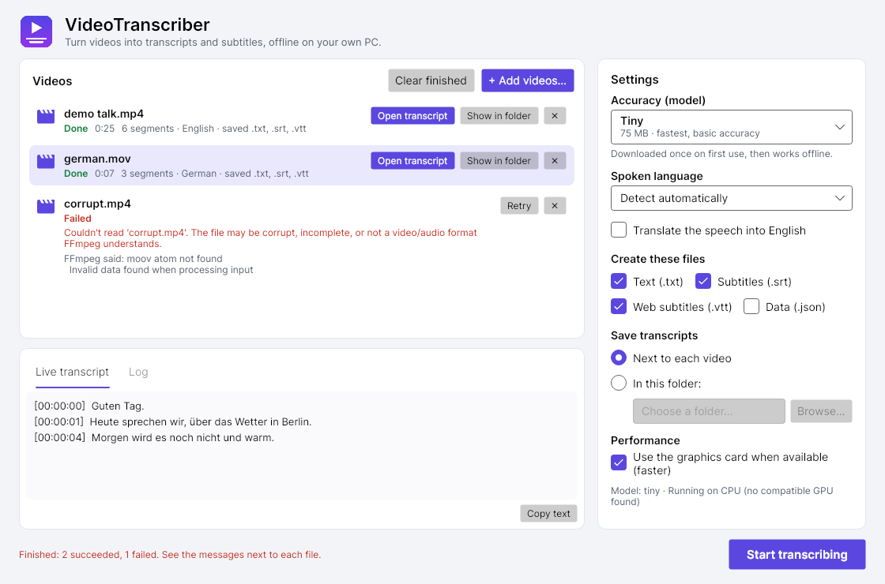

# VideoTranscriber

Turn any video into a text transcript and subtitles, on your own PC, with no account and no upload.

VideoTranscriber is a Windows desktop app that runs [OpenAI Whisper](https://github.com/openai/whisper) locally (through [whisper.cpp](https://github.com/ggml-org/whisper.cpp) and [Whisper.net](https://github.com/sandrohanea/whisper.net)). Point it at a video and it writes:

| File | What it is |
| --- | --- |
| `talk.txt` | Plain text transcript |
| `talk.srt` | Subtitles (SubRip), works in VLC, YouTube, Premiere, DaVinci Resolve... |
| `talk.vtt` | Subtitles (WebVTT), for web players and HTML5 `<track>` |
| `talk.json` | Segments with start/end times, for scripts and other tools |

By default you get `.txt` and `.srt`, saved next to the video.



## Download and install

1. Go to the [**Releases**](../../releases/latest) page and download **`VideoTranscriber.exe`**.
2. Put it in a folder of your choice (for example `C:\Tools\VideoTranscriber`). No installer is needed.
3. Double-click it. The first time you start transcribing it offers to download FFmpeg (needed to read videos), and it downloads the Whisper model you picked. Both are one-time downloads; after that it works offline.

The release also has `VideoTranscriber-CUDA.exe` (the same app with NVIDIA CUDA support, see [GPU acceleration](#gpu-acceleration)) and `VideoTranscriber-CLI.exe` (a [command-line version](#command-line) for scripts).

Requirements: 64-bit Windows 11 (or Windows Server 2022 or newer), which is what the Whisper.net speech engine officially supports. It may work on an up-to-date Windows 10, but that is untested. A GPU is optional.

### "Windows protected your PC" (SmartScreen)

The exe isn't code-signed (certificates are expensive for a free tool), so the first time you run it Windows SmartScreen may show **"Windows protected your PC"**. To run it anyway:

1. Click **More info**.
2. Click **Run anyway**.

You may also see a similar warning from your browser when downloading. If you'd rather check the file first, each release includes `SHA256SUMS.txt`. Compare it with the output of `Get-FileHash .\VideoTranscriber.exe` in PowerShell. You can also build the exe yourself from this source code (see [Building from source](#building-from-source)).

## Usage

1. **Add videos**: drag them into the window (files or whole folders), click **Choose videos…**, or drop them onto `VideoTranscriber.exe` in Explorer.
2. **Pick your settings** on the right. The defaults (Base model, automatic language, `.txt` and `.srt` next to the video) suit most people.
3. Click **Start transcribing**. Each video shows its progress, and the recognized text appears live under **Live transcript**.
4. When a video is done, click **Open transcript** or **Show in folder**. **Copy text** copies the transcript to the clipboard.

You can add more videos while others are being transcribed; they wait in the list until you press Start again. **Cancel** stops the current video (nothing half-written is left behind). If a video fails, the reason is shown under it, with a **Retry** button. The **Log** tab has the details, which help when reporting a problem.

Your settings are remembered for next time.

| Setting | What it does |
| --- | --- |
| Accuracy (model) | Tiny, Base, Small or Medium. Bigger is more accurate but slower; see [Choosing a model](#choosing-a-model). |
| Spoken language | "Detect automatically" works well; choose the language if detection gets it wrong. |
| Translate the speech into English | Produces an English transcript of non-English speech. |
| Create these files | Text (`.txt`), Subtitles (`.srt`), Web subtitles (`.vtt`), Data (`.json`). |
| Save transcripts | Next to each video, or all in one folder you choose. If two videos would produce the same name (e.g. `talk.mp4` and `talk.mkv`), the video's extension is kept (`talk.mp4.srt`) so neither is overwritten. |
| Use the graphics card | Uses the GPU when one is available (much faster); turn it off if the GPU causes problems. |

Any format FFmpeg can read works, including `.mp4`, `.mkv`, `.mov`, `.avi`, `.webm`, and audio files such as `.mp3`, `.m4a` and `.wav`.

## Command line

`VideoTranscriber-CLI.exe` does the same from a terminal, which is handy for scripts and batch jobs. Open PowerShell or Command Prompt in the folder with the exe:

```powershell
# Transcribe a video (creates talk.txt and talk.srt next to it)
.\VideoTranscriber-CLI.exe "C:\videos\talk.mp4"

# Better accuracy with a larger model, subtitles only
.\VideoTranscriber-CLI.exe "C:\videos\talk.mp4" --model small --format srt,vtt

# German video, translated to English, saved in another folder
.\VideoTranscriber-CLI.exe interview.mkv --language de --translate --output C:\transcripts

# Every format, several files at once
.\VideoTranscriber-CLI.exe part1.mp4 part2.mp4 --format all
```

Put paths that contain spaces in quotes.

Example output:

```text
VideoTranscriber 1.0.0
Loading the 'base' model (141.1 MB)...
Model loaded in 0.4 s, running on Vulkan (GPU): NVIDIA GeForce RTX 3060

talk.mp4  (12:34, aac audio)
Extracting audio [##############################] 100%  12:34 / 12:34
Transcribing     [#########---------------------]  31%  03:54 / 12:34
  [00:00:00] Welcome, everyone, and thanks for joining.
  [00:00:04] Today we're going to look at...
```

### Command-line options

| Option | Short | Default | Description |
| --- | --- | --- | --- |
| `<video>...` | | (required) | One or more video or audio files. |
| `--model <name>` | `-m` | `base` | Whisper model: `tiny`, `base`, `small` or `medium` (see below). |
| `--language <code>` | `-l` | `auto` | Spoken language as a code (`en`, `de`, `es`, `fr`, `ja`, `zh`...) or `auto` to detect it. |
| `--format <list>` | `-f` | `txt,srt` | Comma-separated: `txt`, `srt`, `vtt`, `json`, or `all`. |
| `--output <folder>` | `-o` | video's folder | Where to save the transcript files. Created if it doesn't exist. |
| `--translate` | `-t` | off | Translate the speech into English instead of transcribing it in the original language. |
| `--cpu` | | off | Don't use the GPU, even if one is available. |
| `--verbose` | | off | Show diagnostic output from the speech engine (helpful for bug reports). |
| `--help` | `-h`, `-?` | | Show help. |
| `--version` | | | Show the version number. |

Existing transcript files with the same name are overwritten. If two videos in one run would produce the same file name (for example `talk.mp4` and `talk.mkv`), the video's extension is kept in the name (`talk.mp4.srt`, `talk.mkv.srt`) so neither overwrites the other.

Exit codes: `0` success, `1` error, `2` invalid command line, `130` cancelled with Ctrl+C.

## Choosing a model

Bigger models are more accurate (especially with accents, background noise, or languages other than English) but slower and use more memory. Each model is downloaded once, the first time you use it.

| Model | Download | RAM needed (approx.) | Speed | Accuracy | Good for |
| --- | --- | --- | --- | --- | --- |
| `tiny` | 75 MB | ~0.5 GB | Fastest | Basic | Quick drafts, clear English speech, slow PCs |
| `base` (default) | 142 MB | ~0.6 GB | Very fast | Good | Everyday use |
| `small` | 466 MB | ~1.2 GB | Moderate | Better | Accents, non-English languages, noisy audio |
| `medium` | 1.5 GB | ~2.5 GB | Slow | Best of these | When accuracy matters most; a GPU is recommended |

On a modern CPU, `base` typically transcribes several times faster than real time; `medium` on a CPU can be slower than real time. With a GPU, all models are much faster.

Models are stored in `%LOCALAPPDATA%\VideoTranscriber\models`. Delete files there to free space. To keep them somewhere else (for example on a USB drive), set the environment variable `VIDEOTRANSCRIBER_MODELS` to a folder path.

### Offline use

The model is downloaded from Hugging Face on first use. If the PC is offline or Hugging Face is blocked, VideoTranscriber prints the download link and the exact path to save the file to, so you can download it on another computer and copy it over. For example, `ggml-base.bin` from `https://huggingface.co/ggerganov/whisper.cpp/resolve/main/ggml-base.bin` goes into `%LOCALAPPDATA%\VideoTranscriber\models\ggml-base.bin`.

## GPU acceleration

VideoTranscriber picks the fastest engine that works on your PC and falls back automatically:

1. **NVIDIA CUDA**: only in `VideoTranscriber-CUDA.exe` (see below).
2. **Vulkan**: works with the regular graphics driver on most NVIDIA, AMD and Intel GPUs. Included in the standard `VideoTranscriber.exe`.
3. **CPU**: always available. Uses AVX2 when the processor supports it, otherwise a slower compatibility mode.

The settings panel shows what is being used after the first video starts ("Running on …"; the command line prints the same). If you see `CPU (no compatible GPU found)`, update your graphics driver to get Vulkan support. If the GPU causes problems (crashes, garbled output), untick **Use the graphics card** (or pass `--cpu` on the command line).

**CUDA build.** Releases also include `VideoTranscriber-CUDA.exe`, a much larger download (~450 MB) that adds NVIDIA CUDA support. It only helps if you have an NVIDIA GPU **and** the [CUDA Toolkit](https://developer.nvidia.com/cuda-downloads) (version 12 or 13) installed, because it needs the toolkit's cuBLAS libraries. Without the toolkit it behaves like the standard build. For most people, Vulkan in the standard build is the easier choice.

Note: the first launch of a new version takes a few extra seconds while Windows unpacks the bundled engine into `%TEMP%\.net\VideoTranscriber`. Later launches are fast.

## FFmpeg

VideoTranscriber uses [FFmpeg](https://ffmpeg.org/) (`ffmpeg.exe` and `ffprobe.exe`) to read video files and extract the audio. It looks for them in this order:

1. Next to `VideoTranscriber.exe` (or in an `ffmpeg` subfolder next to it)
2. `%LOCALAPPDATA%\VideoTranscriber\ffmpeg` (where the automatic download goes)
3. Your `PATH`

If FFmpeg isn't found, VideoTranscriber offers to download it (about 200 MB, from the [BtbN FFmpeg builds](https://github.com/BtbN/FFmpeg-Builds) on GitHub). Click **Download** (or answer `Y` on the command line) and it's installed for future runs. To install it yourself instead:

- `winget install --id Gyan.FFmpeg`, then open a new terminal window, **or**
- download a build from [gyan.dev](https://www.gyan.dev/ffmpeg/builds/) or [BtbN](https://github.com/BtbN/FFmpeg-Builds/releases) and copy `ffmpeg.exe` and `ffprobe.exe` from its `bin` folder next to `VideoTranscriber.exe`.

## Troubleshooting

| Message | What to do |
| --- | --- |
| `File not found` (command line) | Check the path. Use quotes around paths with spaces. |
| `Couldn't read '...'. The file may be corrupt...` | The file is damaged, incomplete (still downloading?), or not a media file. Try playing it in VLC. |
| `... has no audio track` | The video has no sound, so there's nothing to transcribe. |
| `FFmpeg was not found` | See [FFmpeg](#ffmpeg). |
| `Couldn't download the '...' model: no internet connection` | Connect to the internet for the first run, or download the model manually (see [Offline use](#offline-use)). |
| `Couldn't load the speech recognition engine` | Install the [Microsoft Visual C++ Redistributable (x64)](https://aka.ms/vs/17/release/vc_redist.x64.exe), then try again with **Use the graphics card** unticked (`--cpu`). |
| The transcript has repeated or invented sentences | Whisper can do this on long silences or music. Try a larger model, or choose the spoken language instead of automatic detection. |

Long videos are fine: audio is processed in 10-minute pieces, so memory use doesn't grow with the length of the video. A temporary WAV file (about 115 MB per hour of video) is written to your temp folder and deleted when the run ends, including when you cancel.

## Building from source

Requires the [.NET 8 SDK](https://dotnet.microsoft.com/download/dotnet/8.0).

```powershell
git clone https://github.com/Ixfolia/video-transcript-generator.git
cd video-transcript-generator

dotnet test                                    # run the unit tests
dotnet run --project src/VideoTranscriber.Gui  # start the desktop app
dotnet run --project src/VideoTranscriber.Cli -- "C:\videos\talk.mp4"

# Self-contained single-file exes:
#   desktop app:  src/VideoTranscriber.Gui/bin/Release/net8.0/win-x64/publish/VideoTranscriber.exe
#   command line: src/VideoTranscriber.Cli/bin/Release/net8.0/win-x64/publish/VideoTranscriber-CLI.exe
dotnet publish -c Release -r win-x64 --self-contained -p:PublishSingleFile=true

# Same, with NVIDIA CUDA support
dotnet publish -c Release -r win-x64 --self-contained -p:PublishSingleFile=true -p:IncludeCuda=true
```

It also builds and runs on Linux x64 (`-r linux-x64`), which is how it's developed and tested in CI.

### Releasing

Push a version tag and GitHub Actions builds, tests and smoke-tests each exe on Windows, then attaches `VideoTranscriber.exe`, `VideoTranscriber-CUDA.exe`, `VideoTranscriber-CLI.exe` and `SHA256SUMS.txt` to a new GitHub Release:

```bash
git tag v1.0.0
git push origin v1.0.0
```

The workflow is in [`.github/workflows/release.yml`](.github/workflows/release.yml). Run it manually from the Actions tab to build without publishing a release.

### Project layout

```text
src/
  VideoTranscriber.Gui/         desktop app (Avalonia): VideoTranscriber.exe
    Views/                      main window, dialogs and styles (XAML)
    ViewModels/                 queue, settings and per-video state
    Services/                   file pickers, saved settings, status reporting
  VideoTranscriber.Cli/         command-line app (System.CommandLine): VideoTranscriber-CLI.exe
  VideoTranscriber.Core/        shared engine, no user interface
    Audio/                      AudioExtractor (FFMpegCore), streaming WavReader, AudioChunker
    Ffmpeg/                     FFmpeg discovery and optional download
    Models/                     ModelManager: model cache and download
    Transcription/              Transcriber (Whisper.net), runtime selection, language list
    Jobs/                       TranscriptionJobRunner: extract, transcribe and save one file
    Output/                     timestamp formatting and the txt/srt/vtt/json writers
    Infrastructure/             HTTP downloader, paths, status reporting interface
  VideoTranscriber.App.props    packaging shared by both exes (native runtimes, single file)
tests/VideoTranscriber.Tests/   xUnit tests
build/smoke-test.ps1            end-to-end check of a published exe on Windows
```

## Third-party software

- [Whisper.net](https://github.com/sandrohanea/whisper.net) and [whisper.cpp](https://github.com/ggml-org/whisper.cpp) (MIT) for speech recognition.
- [OpenAI Whisper](https://github.com/openai/whisper) model weights (MIT), downloaded on first use.
- [FFMpegCore](https://github.com/rosenbjerg/FFMpegCore) (MIT) to drive FFmpeg.
- [FFmpeg](https://ffmpeg.org/) (LGPL/GPL) is not included in the exe. It's used from your system or downloaded separately at your request.
- [Avalonia](https://avaloniaui.net/) (MIT) for the desktop user interface, with the [Inter](https://rsms.me/inter/) font (OFL).
- [CommunityToolkit.Mvvm](https://github.com/CommunityToolkit/dotnet) (MIT).
- [System.CommandLine](https://github.com/dotnet/command-line-api) (MIT) for argument parsing.
- Microsoft Visual C++ runtime DLLs may be bundled in release builds under Microsoft's redistribution terms.

## License

[MIT](LICENSE)
